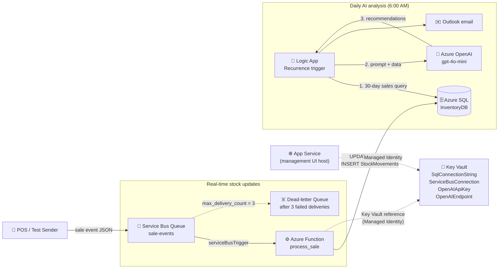

# ☁️ AI Inventory Tracker on Azure


An event-driven inventory system. Sale events are buffered in Azure Service Bus and processed by an Azure Function that updates stock counts in Azure SQL in near real time. Each morning, a Logic App summarizes 30 days of sales, asks Azure OpenAI for restock recommendations, and emails the result. Infrastructure is provisioned with Terraform.

---

## 📌 Overview

Small retailers and service businesses typically manage stock from manual counts, which produces two failure modes: stockouts during peak demand and cash tied up in slow-moving inventory. A reactive alert ("item A is low") does not tell the buyer how much to order or by when. This project builds the predictive version: it combines current stock, minimum thresholds, 30-day sales velocity, and supplier lead time, and returns specific ordering guidance.

| Detail | Value |
|---|---|
| **Difficulty** | Intermediate |
| **Time to complete** | 6 to 7 hours |
| **Cloud Provider** | Microsoft Azure |
| **Core Services** | Service Bus, Azure Functions, Azure SQL Database, Azure OpenAI (`gpt-4o-mini`), Key Vault, Logic Apps, App Service, Log Analytics |
| **Languages / Tools** | Python 3.10, T-SQL, Terraform (`azurerm ~> 3.0`), Azure CLI |
| **Core Concepts** | Message-queue decoupling, event-driven processing, secrets management with Key Vault references, LLM-assisted reporting |
| **Prerequisite** | Azure OpenAI access approved on the subscription (see Project 4) |

---

## 🏗️ Architecture



**How it works:** A point-of-sale system (or a test message) places a sale event on the `sale-events` queue and receives immediate confirmation that the message is durably stored. The Function is triggered by each message, decrements `CurrentStock`, writes an audit row to `StockMovements`, and logs a `LOW STOCK` warning when stock reaches the minimum. A separate Logic App runs daily, aggregates the last 30 days of sales per product, sends that data to `gpt-4o-mini` with a restock-analyst prompt, and emails the response.

### What Gets Built

```
rg-inventory-<yourname>
├── Azure SQL Server + Database (InventoryDB)
│   ├── Products
│   ├── StockMovements
│   └── Suppliers
├── App Service Plan (B1) + Linux Web App          management tool host (system-assigned identity)
├── Azure OpenAI account
│   └── Deployment: gpt-4o-mini                    restock recommendations
├── Key Vault (RBAC)                               DB, Service Bus, and OpenAI secrets
├── Service Bus Namespace (Standard) + Queue       sale-events
├── Storage Account + Consumption Plan (Y1)        Function runtime
├── Linux Function App                             sale event processor
├── Logic App workflow                             daily analysis and email
└── Log Analytics Workspace
```

### Why Service Bus?

If the POS system calls the web application directly and the application is restarting, deploying, or scaling, the sale event is lost and inventory drifts out of sync. Service Bus acts as a durable buffer:

- The sender gets an acknowledgment as soon as the message is stored.
- The consumer processes the message when it is ready, even tens of seconds later.
- Failed processing is retried automatically, and poison messages move to a dead-letter queue instead of looping forever.

| Queue setting | Value | Purpose |
|---|---|---|
| `sku` | `Standard` | Adds topics, duplicate detection, and transactions over Basic, which is queues only; leaves room to grow beyond a single queue |
| `max_size_in_megabytes` | `1024` | 1 GB cap; a sale event is under 1 KB, so it is not a practical limit |
| `lock_duration` | `PT1M` | Message is locked for 1 minute while being processed; if the Function fails, the lock expires and the message is redelivered |
| `max_delivery_count` | `3` | After 3 failed deliveries the message is dead-lettered for inspection |

---

## ✅ Prerequisites

- Active Azure subscription with **Azure OpenAI access approved** (`gpt-4o-mini` available in the chosen region)
- Terraform and Azure CLI installed (`terraform -version`, `az version`), signed in with `az login`
- Python 3 and `pip`
- A Microsoft 365 / Outlook account for the Logic App email step

---

## 🗂️ Repository Layout

```
inventory-tracker-001/
├── main.tf
├── variables.tf
├── outputs.tf
├── terraform.tfvars                  (gitignored, holds real values)
└── function_app/
    ├── host.json                     runtime config and extension bundle (zip root)
    ├── requirements.txt
    └── process_sale/                 subfolder name must match the function name
        ├── function.json             Service Bus trigger binding
        └── process_sale.py           sale processing logic
```

> **Packaging requirement:** On Linux, the function files must live in a subfolder named after the function, and `host.json` must be at the package root. A `serviceBusTrigger` additionally requires the extension bundle declared in `host.json`; without it the function registers but never receives messages.

---

## 🚀 Deployment Steps

### Step 1: Create the Project Structure

**Mac / Linux**
```bash
mkdir -p ~/inventory-tracker-001/function_app/process_sale
cd ~/inventory-tracker-001
touch main.tf variables.tf outputs.tf terraform.tfvars
touch function_app/host.json function_app/requirements.txt
touch function_app/process_sale/function.json function_app/process_sale/process_sale.py
```

**Windows (PowerShell)**
```powershell
New-Item -ItemType Directory -Force -Path "$HOME\inventory-tracker-001\function_app\process_sale" | Out-Null
cd "$HOME\inventory-tracker-001"
New-Item -ItemType File main.tf, variables.tf, outputs.tf, terraform.tfvars
New-Item -ItemType File function_app\host.json, function_app\requirements.txt
New-Item -ItemType File function_app\process_sale\function.json, function_app\process_sale\process_sale.py
```

Add a `.gitignore` before committing anything (`terraform.tfvars` holds the SQL admin password):
```
terraform.tfvars
*.tfvars
.terraform/
.terraform.lock.hcl
*.tfstate
*.tfstate.backup
__pycache__/
.python_packages/
function_deploy.zip
```

### Step 2: Variables

**`variables.tf`**
```hcl
variable "yourname" {
  type = string
}

variable "location" {
  type    = string
  default = "East US"
}

variable "sql_admin_login" {
  type    = string
  default = "sqladmin"
}

variable "sql_admin_password" {
  type      = string
  sensitive = true
}

variable "alert_email" {
  description = "Email address to receive daily restock recommendations."
  type        = string
}

variable "tags" {
  type = map(string)
  default = {
    project    = "inventory-tracker"
    managed_by = "terraform"
  }
}
```

**`terraform.tfvars`**
```hcl
yourname           = "reco"
location           = "East US"
sql_admin_login    = "sqladmin"
sql_admin_password = "<strong-unique-password>"
alert_email        = "your.email@example.com"
```

### Step 3: Function Code

**`function_app/host.json`**
```json
{
  "version": "2.0",
  "extensionBundle": {
    "id": "Microsoft.Azure.Functions.ExtensionBundle",
    "version": "[4.*, 5.0.0)"
  }
}
```

**`function_app/requirements.txt`**
```
azure-functions
pyodbc==4.0.39
```

**`function_app/process_sale/function.json`**
```json
{
  "scriptFile": "process_sale.py",
  "bindings": [
    {
      "name": "msg",
      "type": "serviceBusTrigger",
      "direction": "in",
      "queueName": "sale-events",
      "connection": "ServiceBusConnection",
      "isSessionsEnabled": false
    }
  ]
}
```

`serviceBusTrigger` binds the function to the queue; every message invokes it. `connection` names an **app setting** (not a literal string), and `queueName` must match the queue created by Terraform. `isSessionsEnabled: false` processes messages without session grouping, which is correct for a simple queue.

**`function_app/process_sale/process_sale.py`**
```python
import azure.functions as func
import pyodbc
import json
import os
import logging


def main(msg: func.ServiceBusMessage):
    """
    Triggered by every message that lands in the sale-events queue.
    Parses the sale event and decrements the product's stock count in SQL.
    Logs a warning when stock falls to or below the minimum threshold.
    """
    sale_event = json.loads(msg.get_body().decode("utf-8"))
    product_id = sale_event.get("product_id")
    quantity   = sale_event.get("quantity", 1)
    sale_id    = sale_event.get("sale_id", "unknown")

    logging.info(f"Processing sale {sale_id}: {quantity}x product {product_id}")

    conn_str = os.environ["SqlConnectionString"]
    conn     = pyodbc.connect(conn_str)
    cursor   = conn.cursor()

    try:
        # All statements share one transaction: either every change commits
        # or none do.
        cursor.execute("""
            UPDATE Products
            SET CurrentStock = CurrentStock - ?,
                LastSaleDate = GETUTCDATE()
            WHERE ProductId = ?
        """, quantity, product_id)

        cursor.execute("""
            INSERT INTO StockMovements (ProductId, MovementType, Quantity, Reference, MovedAt)
            VALUES (?, 'SALE', ?, ?, GETUTCDATE())
        """, product_id, quantity, sale_id)

        cursor.execute("""
            SELECT ProductName, CurrentStock, MinimumStock
            FROM Products
            WHERE ProductId = ?
        """, product_id)

        row = cursor.fetchone()
        if row:
            product_name, current_stock, min_stock = row
            if current_stock <= min_stock:
                logging.warning(
                    f"LOW STOCK: {product_name} | Current: {current_stock} | Minimum: {min_stock}"
                )

        conn.commit()
        logging.info(f"Stock updated for product {product_id}. Sale {sale_id} processed.")

    except Exception as e:
        conn.rollback()
        logging.error(f"Failed to process sale {sale_id}: {e}")
        raise  # Re-raising makes Service Bus retry, then dead-letter after 3 attempts

    finally:
        cursor.close()
        conn.close()
```

### Step 4: Infrastructure (`main.tf`)

*Provider*
```hcl
terraform {
  required_providers {
    azurerm = {
      source  = "hashicorp/azurerm"
      version = "~> 3.0"
    }
  }
}

provider "azurerm" {
  features {
    key_vault {
      purge_soft_delete_on_destroy    = true
      recover_soft_deleted_key_vaults = true
    }
  }
}

data "azurerm_client_config" "current" {}
```

*Resource group*
```hcl
resource "azurerm_resource_group" "main" {
  name     = "rg-inventory-${var.yourname}"
  location = var.location
  tags     = var.tags
}
```

*Key Vault.* RBAC mode is used, so the deploying identity must grant itself a role before it can write secrets; every secret below depends on that assignment.
```hcl
resource "azurerm_key_vault" "main" {
  name                       = "kv-inventory-${var.yourname}"
  location                   = var.location
  resource_group_name        = azurerm_resource_group.main.name
  tenant_id                  = data.azurerm_client_config.current.tenant_id
  sku_name                   = "standard"
  enable_rbac_authorization  = true
  soft_delete_retention_days = 7
  tags                       = var.tags
}

resource "azurerm_role_assignment" "kv_admin_self" {
  scope                = azurerm_key_vault.main.id
  role_definition_name = "Key Vault Administrator"
  principal_id         = data.azurerm_client_config.current.object_id
}
```

*Azure SQL.* The connection string includes an explicit ODBC driver, which `pyodbc` requires.
```hcl
resource "azurerm_mssql_server" "main" {
  name                         = "sql-inventory-${var.yourname}"
  resource_group_name          = azurerm_resource_group.main.name
  location                     = var.location
  version                      = "12.0"
  administrator_login          = var.sql_admin_login
  administrator_login_password = var.sql_admin_password
  minimum_tls_version          = "1.2"
  tags                         = var.tags
}

resource "azurerm_mssql_firewall_rule" "allow_azure_services" {
  name             = "AllowAzureServices"
  server_id        = azurerm_mssql_server.main.id
  start_ip_address = "0.0.0.0"
  end_ip_address   = "0.0.0.0"
}

resource "azurerm_mssql_database" "inventory" {
  name      = "InventoryDB"
  server_id = azurerm_mssql_server.main.id
  sku_name  = "Basic"
  tags      = var.tags
}

resource "azurerm_key_vault_secret" "db_connection" {
  name         = "SqlConnectionString"
  key_vault_id = azurerm_key_vault.main.id
  value        = "Driver={ODBC Driver 18 for SQL Server};Server=tcp:sql-inventory-${var.yourname}.database.windows.net,1433;Database=InventoryDB;Uid=${var.sql_admin_login};Pwd=${var.sql_admin_password};Encrypt=yes;TrustServerCertificate=no;"

  depends_on = [azurerm_role_assignment.kv_admin_self]
}
```

*Service Bus*
```hcl
resource "azurerm_servicebus_namespace" "main" {
  name                = "sbns-inventory-${var.yourname}"
  location            = var.location
  resource_group_name = azurerm_resource_group.main.name
  sku                 = "Standard"
  tags                = var.tags
}

resource "azurerm_servicebus_queue" "sale_events" {
  name         = "sale-events"
  namespace_id = azurerm_servicebus_namespace.main.id

  max_size_in_megabytes = 1024
  lock_duration         = "PT1M"
  max_delivery_count    = 3
}

resource "azurerm_key_vault_secret" "servicebus_connection" {
  name         = "ServiceBusConnection"
  key_vault_id = azurerm_key_vault.main.id
  value        = azurerm_servicebus_namespace.main.default_primary_connection_string

  depends_on = [azurerm_role_assignment.kv_admin_self]
}
```

*Azure OpenAI*
```hcl
resource "azurerm_cognitive_account" "openai" {
  name                = "oai-inventory-${var.yourname}"
  location            = var.location
  resource_group_name = azurerm_resource_group.main.name
  kind                = "OpenAI"
  sku_name            = "S0"

  identity {
    type = "SystemAssigned"
  }

  tags = var.tags
}

resource "azurerm_cognitive_deployment" "gpt4o_mini" {
  name                 = "gpt-4o-mini"
  cognitive_account_id = azurerm_cognitive_account.openai.id

  model {
    format  = "OpenAI"
    name    = "gpt-4o-mini"
    version = "2024-07-18"
  }

  scale {
    type     = "Standard"
    capacity = 10
  }
}

resource "azurerm_key_vault_secret" "openai_key" {
  name         = "OpenAIApiKey"
  key_vault_id = azurerm_key_vault.main.id
  value        = azurerm_cognitive_account.openai.primary_access_key

  depends_on = [azurerm_role_assignment.kv_admin_self]
}

resource "azurerm_key_vault_secret" "openai_endpoint" {
  name         = "OpenAIEndpoint"
  key_vault_id = azurerm_key_vault.main.id
  value        = azurerm_cognitive_account.openai.endpoint

  depends_on = [azurerm_role_assignment.kv_admin_self]
}
```

*App Service Plan and Web App.* The web app is the host for an internal management UI. It reads secrets through its Managed Identity (`Key Vault Secrets User`, read-only).
```hcl
resource "azurerm_service_plan" "main" {
  name                = "asp-inventory-${var.yourname}"
  resource_group_name = azurerm_resource_group.main.name
  location            = var.location
  os_type             = "Linux"
  sku_name            = "B1"
  tags                = var.tags
}

resource "azurerm_linux_web_app" "inventory_app" {
  name                = "app-inventory-${var.yourname}"
  resource_group_name = azurerm_resource_group.main.name
  location            = var.location
  service_plan_id     = azurerm_service_plan.main.id

  identity {
    type = "SystemAssigned"
  }

  site_config {
    application_stack {
      python_version = "3.11"
    }
  }

  app_settings = {
    "KEY_VAULT_URI"        = azurerm_key_vault.main.vault_uri
    "SERVICEBUS_NAMESPACE" = azurerm_servicebus_namespace.main.name
    "SERVICEBUS_QUEUE"     = azurerm_servicebus_queue.sale_events.name
  }

  tags = var.tags
}

resource "azurerm_role_assignment" "app_kv_reader" {
  scope                = azurerm_key_vault.main.id
  role_definition_name = "Key Vault Secrets User"
  principal_id         = azurerm_linux_web_app.inventory_app.identity[0].principal_id
}
```

*Function App.* `SqlConnectionString` is a Key Vault reference, so the SQL password never appears in the Function's configuration. `ServiceBusConnection` must be the **literal connection string**, because the Service Bus trigger resolves it at host startup. `WEBSITE_RUN_FROM_PACKAGE` is intentionally omitted: combined with `config-zip` deployment it produces a 409 conflict.
```hcl
resource "azurerm_storage_account" "functions" {
  name                     = "stfninventory${var.yourname}"
  resource_group_name      = azurerm_resource_group.main.name
  location                 = var.location
  account_tier             = "Standard"
  account_replication_type = "LRS"
  tags                     = var.tags
}

resource "azurerm_service_plan" "functions" {
  name                = "asp-fn-inventory-${var.yourname}"
  resource_group_name = azurerm_resource_group.main.name
  location            = var.location
  os_type             = "Linux"
  sku_name            = "Y1"
  tags                = var.tags
}

resource "azurerm_linux_function_app" "sale_processor" {
  name                       = "func-inventory-${var.yourname}"
  resource_group_name        = azurerm_resource_group.main.name
  location                   = var.location
  storage_account_name       = azurerm_storage_account.functions.name
  storage_account_access_key = azurerm_storage_account.functions.primary_access_key
  service_plan_id            = azurerm_service_plan.functions.id

  site_config {
    application_stack {
      python_version = "3.10"
    }
  }

  app_settings = {
    "SqlConnectionString"      = "@Microsoft.KeyVault(VaultName=kv-inventory-${var.yourname};SecretName=SqlConnectionString)"
    "ServiceBusConnection"     = azurerm_servicebus_namespace.main.default_primary_connection_string
    "FUNCTIONS_WORKER_RUNTIME" = "python"
    "AzureWebJobsStorage"      = azurerm_storage_account.functions.primary_connection_string
  }

  identity {
    type = "SystemAssigned"
  }

  tags = var.tags
}

resource "azurerm_role_assignment" "func_kv_reader" {
  scope                = azurerm_key_vault.main.id
  role_definition_name = "Key Vault Secrets User"
  principal_id         = azurerm_linux_function_app.sale_processor.identity[0].principal_id
}
```

*Logic App and Log Analytics.* Terraform creates the empty workflow; its steps are configured in the designer (Step 10).
```hcl
resource "azurerm_logic_app_workflow" "daily_recommendations" {
  name                = "la-restock-daily-${var.yourname}"
  location            = var.location
  resource_group_name = azurerm_resource_group.main.name
  tags                = var.tags
}

resource "azurerm_log_analytics_workspace" "main" {
  name                = "law-inventory-${var.yourname}"
  location            = var.location
  resource_group_name = azurerm_resource_group.main.name
  sku                 = "PerGB2018"
  retention_in_days   = 30
  tags                = var.tags
}
```

### Step 5: Outputs

**`outputs.tf`**
```hcl
output "web_app_url" {
  value = "https://${azurerm_linux_web_app.inventory_app.default_hostname}"
}

output "function_app_name" {
  value = azurerm_linux_function_app.sale_processor.name
}

output "sql_server_fqdn" {
  value = azurerm_mssql_server.main.fully_qualified_domain_name
}

output "servicebus_namespace" {
  value = azurerm_servicebus_namespace.main.name
}

output "key_vault_uri" {
  value = azurerm_key_vault.main.vault_uri
}
```

### Step 6: Deploy the Infrastructure

```bash
terraform init
terraform plan
terraform apply
```

Expect roughly **23 resources** to be added. Provisioning takes 5 to 8 minutes (SQL and Service Bus are the slow parts).

### Step 7: Create the Database Schema

1. Portal → `InventoryDB` → **Query editor**, and sign in with the SQL admin credentials.
2. If prompted, allow your client IP through the SQL server firewall.
3. Run the three blocks below.

**Block 1: Tables**
```sql
CREATE TABLE Suppliers (
    SupplierId   INT IDENTITY(1,1) PRIMARY KEY,
    SupplierName NVARCHAR(200) NOT NULL,
    ContactEmail NVARCHAR(200),
    LeadTimeDays INT DEFAULT 3
);

CREATE TABLE Products (
    ProductId    INT IDENTITY(1,1) PRIMARY KEY,
    ProductName  NVARCHAR(200) NOT NULL,
    SKU          NVARCHAR(50) UNIQUE,
    CurrentStock INT DEFAULT 0,
    MinimumStock INT DEFAULT 10,
    UnitCost     DECIMAL(10,2),
    SupplierId   INT,
    LastSaleDate DATETIME2,
    CreatedAt    DATETIME2 DEFAULT GETUTCDATE()
);

CREATE TABLE StockMovements (
    MovementId   INT IDENTITY(1,1) PRIMARY KEY,
    ProductId    INT REFERENCES Products(ProductId),
    MovementType NVARCHAR(20),  -- SALE | RESTOCK | ADJUSTMENT
    Quantity     INT NOT NULL,
    Reference    NVARCHAR(100),
    MovedAt      DATETIME2 DEFAULT GETUTCDATE()
);
```

**Block 2: Seed data**
```sql
INSERT INTO Suppliers (SupplierName, ContactEmail, LeadTimeDays)
VALUES ('Primary Supplier Co', 'orders@supplier.com', 3),
       ('Backup Supplier Inc', 'supply@backup.com', 7);

INSERT INTO Products (ProductName, SKU, CurrentStock, MinimumStock, UnitCost, SupplierId)
VALUES ('Laptop',         'LAP-001', 15, 5,  899.99, 1),
       ('Wireless Mouse', 'MSE-001', 8,  10, 29.99,  1),
       ('USB-C Hub',      'HUB-001', 3,  10, 49.99,  2),
       ('Monitor',        'MON-001', 12, 5,  299.99, 1),
       ('Keyboard',       'KEY-001', 20, 8,  79.99,  1);
```

**Block 3: Verify**
```sql
SELECT p.ProductName, p.CurrentStock, p.MinimumStock, s.SupplierName
FROM Products p
JOIN Suppliers s ON p.SupplierId = s.SupplierId;
```

### Step 8: Package and Deploy the Function

`pyodbc` is a compiled library. The Function App runs on Linux, so the dependency must be installed as a **Linux wheel**, not built for the local OS. Installing with a plain `pip install --target` from a Mac or Windows machine packages binaries that fail to import in Azure.

**Mac / Linux**
```bash
cd function_app
pip3 install -r requirements.txt \
  --target .python_packages/lib/site-packages \
  --platform manylinux2014_x86_64 \
  --python-version 3.10 \
  --implementation cp \
  --only-binary=:all:
zip -r ../function_deploy.zip .
cd ..

az functionapp deployment source config-zip \
  --resource-group rg-inventory-reco \
  --name func-inventory-reco \
  --src function_deploy.zip
```

**Windows (PowerShell)**
```powershell
cd function_app
pip install -r requirements.txt `
  --target .python_packages\lib\site-packages `
  --platform manylinux2014_x86_64 `
  --python-version 3.10 `
  --implementation cp `
  --only-binary=:all:
Compress-Archive -Path * -DestinationPath ..\function_deploy.zip -Force
cd ..

az functionapp deployment source config-zip `
  --resource-group rg-inventory-reco `
  --name func-inventory-reco `
  --src function_deploy.zip
```

Replace `reco` with your `yourname` value. Confirm `host.json` is at the zip root and `process_sale/function.json` sits inside the subfolder (`unzip -l function_deploy.zip`).

### Step 9: Test the Sale Event Flow

Send a test message to the queue:

```bash
az servicebus message send \
  --resource-group rg-inventory-reco \
  --namespace-name sbns-inventory-reco \
  --queue-name sale-events \
  --body '{"sale_id":"TEST-001","product_id":1,"quantity":2}'
```

If your CLI version does not include that command, use the portal instead: Service Bus namespace → **Queues** → `sale-events` → **Service Bus Explorer** → **Send messages**, and paste the same JSON body.

Wait about 30 seconds, then confirm in the Query editor:

```sql
SELECT ProductName, CurrentStock FROM Products WHERE ProductId = 1;
SELECT * FROM StockMovements;
```

The Laptop should show `CurrentStock = 13` (15 minus 2), and `StockMovements` should contain one `SALE` row with reference `TEST-001`.

### Step 10: Configure the Daily Recommendation Logic App

Portal → `la-restock-daily-<yourname>` → **Logic app designer**.

1. **Trigger:** Recurrence, every 1 day at 6:00 AM (set the time zone explicitly).
2. **Action: SQL Server → Execute a query.** Connect to the SQL server and run:
   ```sql
   SELECT
       p.ProductName,
       p.CurrentStock,
       p.MinimumStock,
       p.UnitCost,
       s.SupplierName,
       s.LeadTimeDays,
       SUM(m.Quantity) AS UnitsSoldLast30Days
   FROM Products p
   JOIN Suppliers s ON p.SupplierId = s.SupplierId
   LEFT JOIN StockMovements m
       ON p.ProductId = m.ProductId
       AND m.MovementType = 'SALE'
       AND m.MovedAt >= DATEADD(day, -30, GETUTCDATE())
   GROUP BY p.ProductName, p.CurrentStock, p.MinimumStock, p.UnitCost,
            s.SupplierName, s.LeadTimeDays
   ORDER BY p.CurrentStock ASC;
   ```
3. **Action: HTTP** (calls Azure OpenAI directly).
   - **Method:** `POST`
   - **URI:** `<OpenAIEndpoint>openai/deployments/gpt-4o-mini/chat/completions?api-version=2024-06-01`
   - **Headers:** `Content-Type: application/json` and `api-key: <OpenAIApiKey>`
   - **Body:**
     ```json
     {
       "messages": [
         {
           "role": "system",
           "content": "You are an inventory analyst for a small retailer. For each product, use current stock, minimum stock, 30-day units sold, and supplier lead time to estimate days until stockout. Recommend a specific order quantity and an order-by date. List products by urgency, highest first. Be concise and do not invent data."
         },
         {
           "role": "user",
           "content": "Inventory data (JSON): <insert the SQL query result here using the dynamic content picker>"
         }
       ],
       "temperature": 0.2,
       "max_tokens": 800
     }
     ```
   Retrieve the endpoint and key with the Key Vault connector (**Get secret**) rather than pasting them into the workflow definition.
4. **Action: Office 365 Outlook → Send an email (V2).**
   - **To:** the `alert_email` address
   - **Subject:** `Daily Restock Recommendations`
   - **Body:** the model's reply, using the expression `body('HTTP')?['choices']?[0]?['message']?['content']`
5. **Save**, then use **Run Trigger** to test once without waiting for 6:00 AM.

---

## ✅ Verification Checklist

- [ ] Three tables exist in `InventoryDB`: `Products`, `Suppliers`, `StockMovements`
- [ ] Seed data loaded (2 suppliers, 5 products)
- [ ] Service Bus namespace and `sale-events` queue exist
- [ ] `func-inventory-<yourname>` shows **Running**, and `process_sale` is listed under **Functions**
- [ ] Test sale processed: Laptop stock dropped from 15 to 13
- [ ] `StockMovements` contains a row for `TEST-001`
- [ ] Key Vault contains four secrets: `SqlConnectionString`, `ServiceBusConnection`, `OpenAIApiKey`, `OpenAIEndpoint`
- [ ] Function App → **Configuration** shows a green checkmark on the `SqlConnectionString` Key Vault reference
- [ ] Logic App manual run succeeds and the recommendation email arrives

---

## 🐛 Troubleshooting

| Symptom | Likely Cause | Resolution |
|---|---|---|
| Function never receives messages | `host.json` missing or has no `extensionBundle`; or `ServiceBusConnection` is not the literal connection string | Add the bundle to `host.json`; set `ServiceBusConnection` to the full connection string (not a Key Vault reference); redeploy |
| `process_sale` not listed under Functions | Function files at the zip root instead of `process_sale/` | Restructure, rebuild the zip, redeploy |
| `ImportError` / `cannot open shared object file` for `pyodbc` | Wheel was built for the local OS, or the ODBC runtime library is unavailable | Reinstall with the `--platform manylinux2014_x86_64 ... --only-binary=:all:` flags and redeploy |
| `Data source name not found and no default driver specified` | Connection string has no `Driver=` entry | Include `Driver={ODBC Driver 18 for SQL Server};`; if that driver is not present in the runtime image, try `ODBC Driver 17 for SQL Server` |
| Stock count does not change | Message processed but the DB connection failed | Check Function App → **Monitor** → **Invocations** for the exception; confirm the firewall rule `AllowAzureServices` exists |
| `SqlConnectionString` reference shows an error | Role assignment not yet propagated, or wrong vault or secret name | Wait a few minutes, confirm `func_kv_reader` exists, then restart the Function App |
| `config-zip` returns 409 Conflict | `WEBSITE_RUN_FROM_PACKAGE` set in `app_settings` | Remove it, run `terraform apply`, redeploy |
| Messages accumulate in the queue | Function not running or failing at startup | Redeploy the zip and restart the Function App; check Application logs |
| Messages appear in the dead-letter queue | Processing failed 3 times | Open the dead-letter queue in Service Bus Explorer, read the message and the Function logs, fix the cause, and resubmit |
| Query editor cannot connect | Client IP not allowed on the SQL server | Add your IP in the prompt, or under SQL server → **Networking** |
| Logic App SQL connection fails | Firewall rule not yet propagated | Wait 2 minutes and retry |
| `terraform apply` fails on secrets | Role assignment `kv_admin_self` not yet effective | Re-run `terraform apply`; RBAC propagation can take a minute or two |
| Azure OpenAI deployment fails | No quota or access for `gpt-4o-mini` in the region | Request access or quota, or choose a supported region |

---

## 🧹 Teardown

```bash
terraform destroy
```

Type `yes` to confirm. The App Service B1 plan and the Service Bus Standard namespace carry fixed monthly charges whether or not they are used, so destroy the stack when finished. Because `purge_soft_delete_on_destroy = true`, the Key Vault is purged rather than left in a soft-deleted state.

---

## 🔐 Security & Design Notes

- **Secrets are centralized.** SQL, Service Bus, and OpenAI credentials live in Key Vault under RBAC. The Function and Web App read them through Managed Identity with the read-only `Key Vault Secrets User` role. Only the deploying identity holds `Key Vault Administrator`.
- **Terraform state contains the secrets.** The SQL password, Service Bus key, and OpenAI key pass through Terraform, so they are present in `terraform.tfstate`. Keep state out of Git, and use an encrypted remote backend with RBAC for anything shared.
- **One credential is still a connection string.** The Service Bus trigger requires a literal `ServiceBusConnection` app setting. A hardened version would use identity-based connections (`ServiceBusConnection__fullyQualifiedNamespace` with the `Azure Service Bus Data Receiver` role) and remove the key entirely.
- **SQL network exposure.** The `0.0.0.0` firewall rule allows all Azure services, which is convenient in a lab but broad. Production should use Private Endpoints or restrict access to specific outbound IPs, and should use Entra authentication instead of a shared SQL admin login.
- **Delivery is at-least-once.** Service Bus can redeliver a message after a failure, and `StockMovements` has no uniqueness constraint on the sale reference, so a redelivered message could decrement stock twice. A production system should enforce idempotency (for example, a unique index on `(MovementType, Reference)` and a check before the update).
- **No floor on stock.** The `UPDATE` can drive `CurrentStock` below zero. Add a `CHECK` constraint or a guarded update if negative stock should be rejected.
- **Low stock is logged, not alerted.** The `LOW STOCK` warning goes to the log only; the morning email is the actual notification path. An Azure Monitor alert on that log message would give intraday warnings.
- **Treat model output as advice.** `gpt-4o-mini` receives only aggregated inventory data, but its quantities are estimates. Recommendations are reviewed by a person before any purchase order is placed.

### Scope

The Terraform provisions the Web App as the host for an internal management UI, but this project does not include application code for it. Products, suppliers, and stock levels are managed directly in SQL. Building the CRUD interface is a natural follow-on.

---

## 📚 What I Learned

- Decoupling producers from consumers with Azure Service Bus: queue locking, retry behavior, and dead-lettering
- Building an event-driven Azure Function with a `serviceBusTrigger` and the extension bundle it depends on
- Transactional SQL updates with rollback, and re-raising exceptions so the broker handles retries
- Keeping credentials out of configuration with Key Vault references and Managed Identity under RBAC
- Why compiled Python dependencies must be built for the target platform (Linux wheels) when deploying from a different OS
- Azure Functions Linux packaging rules: `host.json` at the root, function code in a named subfolder, no `WEBSITE_RUN_FROM_PACKAGE` with `config-zip`
- Calling Azure OpenAI over REST from a Logic App and turning SQL aggregates into a structured prompt
- Recognizing the limits of a design: at-least-once delivery, idempotency, and secrets in Terraform state

---

**Author:** Reco
